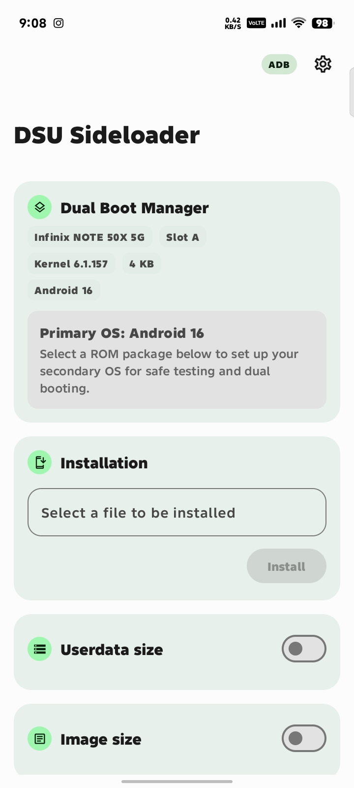
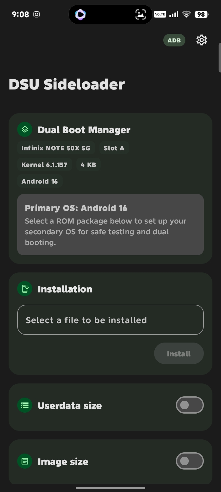

# DSU Sideloader

A modern, open-source tool to easily install and test Generic System Images (GSIs) using Android's native Dynamic System Updates (DSU) feature — without wiping or altering your current OS.

  
  &nbsp;&nbsp;&nbsp;&nbsp;
  

  
  
  

---

## ✨ Highlights & Features

- 🎨 **Material 3 (Material You)**: Dynamic color extraction matching user wallpaper, modernized card containers, and themed icon support.
- ⚡ **Versatile Operation Modes**:
  - **Root**: Fully automated 1-tap installation, boot, and discard directly inside the app.
  - **Shizuku**: Automated installation flow without requiring full root access.
  - **ADB**: Non-root installation helper generating streamlined shell commands.
- 🔀 **Dynamic A/B Slot Dual-Boot**: Seamless dual-boot environment dynamically configuring the inactive slot (`_a`/`_b`), allowing effortless switching between your primary stock OS and a secondary guest OS.
- 🎛️ **Interactive Quick Settings Tile**: Direct OS switcher in your notification shade — tap to switch active slots and reboot between Primary and Secondary OS with a single confirmation.
- 📦 **OTA Payload & Full ROM Support**: Direct installation of complete OTA update packages (`payload.bin` and ROM ZIPs like Evolution X, LineageOS, PixelOS).
- 🧩 **Payload Partition Customizer**: Interactive bottom sheet customizer to inspect and selectively flash physical boot partitions (to the target physical slot) and logical dynamic partitions (into DSU).
- 🛡️ **Automated Boot Partition Safeguards**: Automatically backs up secondary slot boot partitions (`boot`, `init_boot`, `vendor_boot`, `dtbo`) to `/sdcard/DSU_Backup/` before flashing, with automatic restoration when discarding.
- 🔄 **Sticky Mode Toggle**: Switch between temporary one-shot boot and persistent DSU boots directly from Settings or the Dual Boot card.
- 🔍 **Image & Filesystem Inspector**: Automatic asynchronous header inspection detecting **EROFS**, **ext4**, **Android Sparse (`simg`)**, and compressed archives (`.xz`, `.gz`, `.zip`).
- 🧠 **16 KB Memory Page Size Support**: Kernel detection and compatibility advisories for modern 16 KB kernels on Android 15+.
- 🚀 **High-Refresh Performance**: Silky smooth 120Hz/144Hz scrolling and non-blocking background initialization.
- 📤 **One-Tap Share**: Instant Android Share sheet for ADB installation scripts and logcat logs.

---

## 📋 Requirements

- **Android 10 or higher**
- **Unlocked Bootloader** (required for custom GSIs)
- **Dynamic Partitions support** (devices launched with Android 10+)
- **A GSI of your choice**:
  - [Google Official GSIs](https://developer.android.com/topic/generic-system-image/releases)
  - [Treble Community GSIs](https://github.com/phhusson/treble_experimentations/wiki/Generic-System-Image-%28GSI%29-list)

> [!NOTE]
> Ensure the GSI architecture (e.g. `arm64-ab`) matches your device. If your device runs on a 16 KB page size kernel (Android 15+), verify that your chosen GSI supports 16 KB alignment.

---

## 🚀 Quick Start

1. **Download and install** the latest APK from [Releases](https://github.com/CuriousNom/DSU-Sideloader/releases/latest).
2. **Grant storage permission** when prompted to configure a working directory for file preparation.
3. **Select your GSI**: choose any `.img`, `.gz`, `.xz`, or `.zip` (DSU package).
4. **Customize partition sizes** (e.g., adjust Userdata size; default GSI image size is automatically detected).
5. **Tap Install**:
   - **Root / Shizuku**: Installation starts automatically.
   - **ADB**: Run the displayed `adb shell` command on your computer, or tap **Share** to send the command or script directly to your terminal.
6. Once installation completes, reboot into the Dynamic System from your notifications, the app, or the Quick Settings tile!

---

## 🛠️ Operation Modes

| Mode | Root Required? | Capabilities |
| :--- | :---: | :--- |
| **Root** | Yes | Full control: built-in installer, direct reboot to DSU, discard, persistent boot. |
| **Shizuku** | No | Automated DSU service trigger, live progress tracking, error diagnostics. |
| **ADB** | No | Prepares images and generates shell scripts to launch DSU via ADB. |

---

## ❓ Common Questions

<b>The device doesn't boot into the installed GSI after a successful installation. What should I do?</b>

Android Verified Boot (AVB) may be preventing unsigned/custom images from booting. You may need to flash a disabled <code>vbmeta.img</code> (e.g. <code>fastboot --disable-verity --disable-verification flash vbmeta vbmeta.img</code>).

<b>Why is userdata allocation capped?</b>

Android's default <code>gsid</code> service restricts dynamic partition allocations to 40% of available free internal storage.

<b>How do I return to my original system?</b>

By default, DSU installs in one-shot mode. Simply reboot your device to return to your stock system. If you enabled <b>Sticky DSU</b> in Settings, you can disable it in the app before rebooting.

---

## 🤝 Credits & Acknowledgements

- **[VegaBobo](https://github.com/VegaBobo)** — Original creator of DSU Sideloader.
- **[CuriousNom](https://github.com/CuriousNom)** — Maintenance, modern UI refactor, and Android 15+ features.
- **[WSTxda](https://github.com/WSTxda)** — Application icon design.
- **[Pierre-Hugues Husson (phh)](https://github.com/phhusson)** — Generic System Image (GSI) / Project Treble pioneer.
- All contributors and translators who helped improve DSU Sideloader!

---

## 📄 License

DSU Sideloader is licensed under the [GNU General Public License v3.0](LICENSE).
